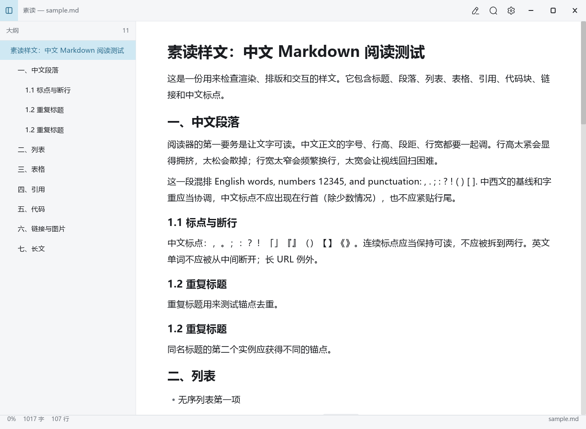

<div align="center">


# 素读 · sudu

**一个安静、轻量、中文优先的 Markdown 阅读器。**

Rust + iced 原生窗口 · 无 Electron · 无 WebView · 渲染态原位编辑


[下载](#下载) · [功能](#功能) · [截图](#截图) · [构建](#构建) · [快捷键](#快捷键)

</div>



## 为什么做素读

市面上的 Markdown 工具大多在往「知识库 / 编辑器 / AI 工作台」方向长：体积越来越大，启动越来越慢，阅读时还要和文件树、插件面板、账号系统抢注意力。

素读反过来，只做一件事：**把 Markdown 读舒服，同时保留一个不打断阅读的编辑方式。**

### 1. 真正的原生，不是浏览器壳

Rust + [iced](https://github.com/iced-rs/iced) 直接创建原生窗口，没有 Electron、没有 WebView2、没有 Qt、没有 Go 运行时。

- GPU 版 `sudu.exe`：**11.6 MB**，空闲 WorkingSet 约 **184 MB**。
- 轻量版 `sudu-tiny.exe`：**7.0 MB**，空闲 WorkingSet 约 **27 MB**。

两种构建来自同一套代码，只切换渲染后端：`wgpu` 负责流畅，`tiny-skia` 负责省内存。

### 2. 编辑不把页面变成源码

大多数 Markdown 编辑器进入编辑后会整页切成等宽源码：标题变小、表格变成竖线、代码块换行，阅读节奏被打断。

素读的编辑是**渲染态原位编辑**：

- 点右上角铅笔或 `Ctrl+E`，页面排版保持不变。
- 点击哪一段、哪个标题、哪个列表项、哪一行表格或代码块，**只有这一块**在原位变成编辑区。
- `**粗体**`、`*斜体*`、`` `行内代码` ``、`[链接](url)` 的标记在这一块内隐藏，按阅读样式显示。
- 表格行只隐藏首尾管道，内部单元格结构保留；代码块隐藏围栏，代码仍是等宽。
- `Ctrl+S` 保存整篇，标记、链接 URL、代码围栏都会原样保留。

> 这是块级实现，不是单缓冲 Typora。跨块连续选择、表格增删列等还在路线图上，详见[已知限制](#已知限制)。

### 3. 中文优先，不是翻译过来的英文阅读器

- 四套主题：白、纸、夜、米黄。
- 正文统一系统无衬线字体（Microsoft YaHei UI / Segoe UI），代码 Consolas。
- 行高、段距、正文宽度按中文阅读调校；中英文混排、中文标点、长文滚动都做过实测。
- 只做标题大纲，不做文件树：章节随手可达，界面退到文字后面。

### 4. 简单到没有第二层

没有插件市场、没有账号、没有云同步、没有 AI 侧栏、没有多标签。

打开就是文档；需要找文件时用 `Ctrl+O` / `Ctrl+Shift+O`，需要定位时用大纲和 `Ctrl+F`。所有功能都在一个 12 MB 的 exe 里。

## 截图

<p align="center">
  
  
</p>

<p align="center">
  <sub>左：阅读视图 + 大纲　右：渲染态原位编辑（页面排版不变，只有当前块可输入）</sub>
</p>

<p align="center">
  
  
</p>

<p align="center">
  <sub>左：表格 / 引用 / 代码块　右：夜间主题</sub>
</p>

<p align="center">
  
</p>

<p align="center">
  <sub>设置菜单：主题、大纲、查找、打开文件、字号、重读</sub>
</p>

## 功能

- 打开 `.md` / `.markdown` / `.mdx`，或 `sudu.exe D:\path\doc.md` 直接打开。
- 内置「快速入门」，第一次启动就有内容可读。
- 左侧大纲：只列标题、按层级缩进、点击跳转、滚动时当前章节高亮。
- 文档内搜索：`Ctrl+F`，`n / m` 计数，`Enter` / `Shift+Enter` / `F3` 跳转，命中高亮。
- 渲染态原位编辑：标题、段落、列表、引用、代码块、表格行逐块编辑。
- 四套主题、字号缩放、自定义无边框标题栏（拖动、双击最大化、四边缩放、最小化、关闭）。
- 打开文件夹后用快速打开列表选文件（不建文件树）。
- 选中/复制、站内相对链接、`#anchor` 跳转、外部链接交给系统浏览器。
- 本地优先：不联网、不上传文档、不需要账号。

## 下载

到 [Releases](https://github.com/Bernardxu123/sudu/releases/latest) 下载：

| 文件 | 适合 | 体积 | 特点 |
|---|---|---:|---|
| `sudu.exe` | 日常使用 | 11.6 MB | GPU 渲染，滚动更跟手 |
| `sudu-tiny.exe` | 老机器 / 省内存 | 7.0 MB | tiny-skia 软件渲染，启动快、占用低 |
| `SHA256SUMS.txt` | 校验 | — | 下载后核对 |

Windows 11 x64，绿色免安装（Windows 10 未单独验证）。exe 未做代码签名，首次运行可能被 SmartScreen 拦截：点「更多信息」→「仍要运行」。介意的话可以自行从源码构建。

## 构建

当前只在 **Windows + WinLibs MinGW-w64 (UCRT) + Rust GNU 工具链** 下验证过。MSVC 未测试；`build.rs` 用 `windres` 编译 exe 图标，需要 MinGW 的 bin 在 PATH。

```powershell
# 1. 安装 Rust GNU 工具链
rustup toolchain install stable-x86_64-pc-windows-gnu

# 2. 安装 WinLibs MinGW-w64 (UCRT)，把 mingw64\bin 放进 PATH
#    需要 gcc.exe 和 windres.exe

# 3. 构建
cd sudu

# GPU 版（默认 wgpu）
cargo build --release

# 轻量版（tiny-skia）
cargo build --release --no-default-features --features backend-tiny
```

产物在 `target/release/sudu.exe`。

> 如果仓库路径包含中文，GNU ld 可能无法链接：把 `CARGO_TARGET_DIR` 指到一个纯 ASCII 路径，例如 `set CARGO_TARGET_DIR=D:\sudu-target`。
>
> 如果构建目录带 Windows Low 完整性标签，生成的 exe 会继承该标签，运行时写普通文件可能报「拒绝访问」。发布前用 `icacls <exe> /setintegritylevel Medium`，本仓库的 `tools/package.ps1` 就是做这件事的。

## 快捷键

| 操作 | 快捷键 |
|---|---|
| 打开文件 | `Ctrl+O` |
| 打开文件夹（快速打开） | `Ctrl+Shift+O` |
| 大纲侧栏 | `Ctrl+B` |
| 文档内查找 | `Ctrl+F` |
| 进入 / 保存渲染态编辑 | `Ctrl+E` / `Ctrl+S` |
| 下一个 / 上一个命中 | `Enter` / `Shift+Enter`，或 `F3` / `Shift+F3` |
| 切换主题 | `Ctrl+T` |
| 放大 / 缩小字号 | `Ctrl+=` / `Ctrl+-` |
| 重读文件 | `Ctrl+R` |
| 关闭浮层 | `Esc` |

## 实现

- **UI / 渲染**：[iced 0.14](https://github.com/iced-rs/iced)，原生窗口、SVG 图标、自定义无边框标题栏。
- **Markdown**：[pulldown-cmark 0.12](https://github.com/raphlinus/pulldown-cmark)，支持表格、删除线、任务列表、YAML frontmatter；原始 HTML、脚注、公式、Mermaid 暂不渲染。
- **选区**：[iced_selection 0.5](https://crates.io/crates/iced_selection)，中文拖选、跨段清除。
- **渲染态编辑**：`src/live.rs` 把 Markdown 源码转换成「隐藏标记的显示文本 + display→source offset map」，活动块用 `text_editor` 编辑，自定义 Highlighter 负责粗体/斜体/链接/行内代码样式；`Block.span` 记录每块可编辑的源码范围，保存时只替换内容，不破坏标记。
- **两种后端**：默认 `backend-wgpu`；`backend-tiny` 用 tiny-skia，适合低配。

## 实测

本机 Windows 11 / 32 GB / 125% DPI，release 构建：

| 后端 | exe | 首事件中位 | 空闲 WorkingSet | 快速滚轮 CPU |
|---|---:|---:|---:|---:|
| wgpu（默认） | 11.6 MB | 968 ms | 184 MB | 0.03 核 |
| tiny-skia | 7.0 MB | 137 ms | 27 MB | 0.56 核 |

`cargo test`：10 个测试通过（标题 slug、链接 percent-decode、搜索、引用/表格类型、内容宽度、块源码范围、行内标记隐藏/样式、链接目标隐藏、显示到源码的编辑映射、引用前缀与表格外框）。

## 已知限制

这是一个 v0.1.0 的阅读器，不是完整编辑器：

- 一次只编辑一块；不能跨块连续选择、拖拽、批量格式化。
- 表格不能增删行列；链接只能改显示文字，不能改 URL；标题不能直接改级别。
- 没有 B/I 工具栏或 Markdown 快捷键。
- 图片目前显示 `[图片：alt]` 占位，不加载本地图片。
- 1 MB 文档仍会一次性构建全部块；虚拟列表待做。
- 会话恢复、单实例、自动更新未做。
- 仅在 Windows 11 x64 验证；Windows 10 / Linux / macOS 未测试。

## 设计参考与许可

- [rmdv](https://github.com/minchenlee/rmdv)（MIT）：主题组织、事件→元素、锚点滚动、`CollectOffsets` 模式给了很大启发。
- [Moeka](https://github.com/MoekaProject/moeka)（GPL-3.0-or-later）：只借鉴「源码 buffer + 标记隐藏 + display↔source 映射」的编辑思路，未复制代码。
- 图标：iconly Light-Outline 的 Search / Setting / Edit / Tick，窗口控件为同风格自绘 SVG；应用图标由项目作者提供。
- 字体不捆绑，使用系统 Microsoft YaHei UI / Segoe UI / Consolas。

素读的源码以 [MIT License](LICENSE) 发布。
