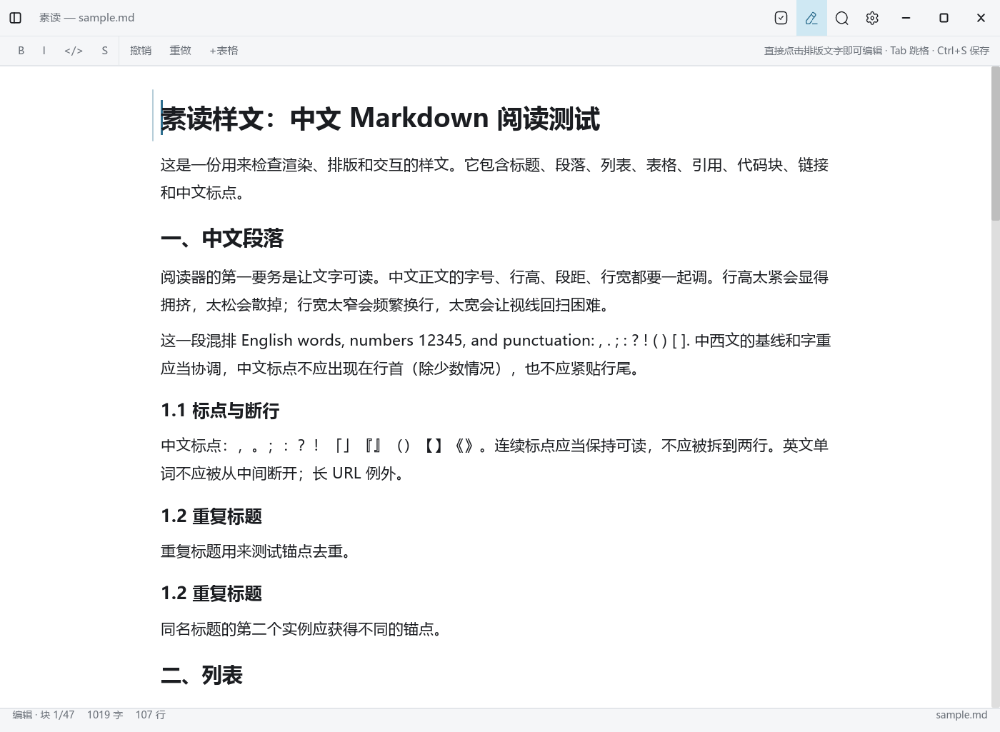
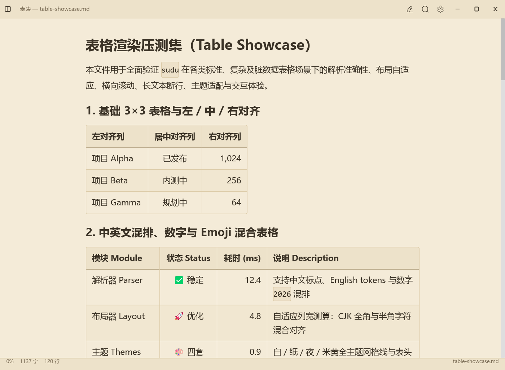
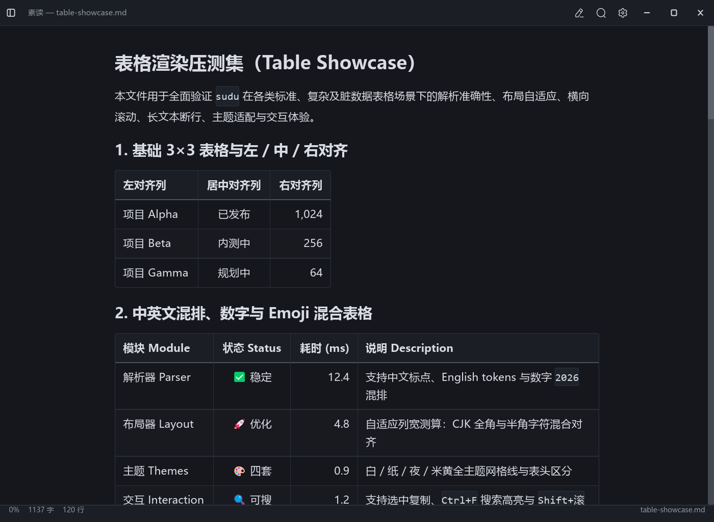
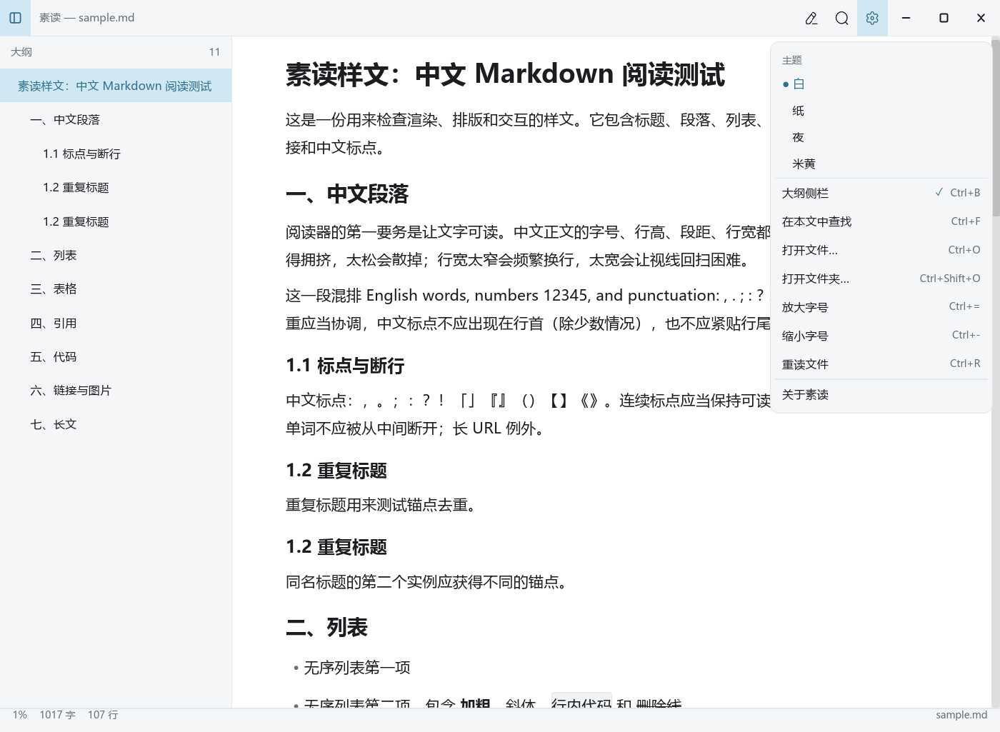

<div align="center">


# 素读 · sudu

**一个安静、轻量、中文优先的 Markdown 阅读与所见即所得编辑器。**

Rust + iced 原生窗口 · 无 Electron · 无 WebView · 连续排版原位所见即所得


[下载](#下载) · [功能](#功能) · [截图](#截图) · [构建](#构建) · [快捷键](#快捷键)

</div>


## 为什么做素读

市面上的 Markdown 工具大多在往「知识库 / 重型工作台」方向长：体积越来越大，启动越来越慢，阅读时还要和文件树、插件面板、账号系统抢注意力。

素读反过来，只做好一件事：**把 Markdown 读舒服，同时在同样的排版样式里直接修改。**

### 1. 真正的原生，不是浏览器壳

Rust + [iced](https://github.com/iced-rs/iced) 直接创建原生窗口，没有 Electron、没有 WebView2、没有 Qt、没有 Go 运行时。

- GPU 版 `sudu.exe`：**11.7 MB**，`wgpu` 硬件渲染，滚动跟手。
- 轻量版 `sudu-tiny.exe`：**7.1 MB**，`tiny-skia` 软件渲染，启动极快。

两种构建来自同一套代码，只切换渲染后端。

### 2. 连续的所见即所得，而不是一段段拆开改源码

大多数 Markdown 编辑器进入编辑后会把页面切回等宽源码，或者把文档拆成彼此割裂的输入框：标题失去层级、表格退化成竖线字符、跨块选区不可用。

素读 v0.2.0 在统一文档组件（`DocWidget`）里实现了**整篇连续的排版原位编辑**：

- 点右上角编辑按钮或 `Ctrl+E`，整篇保留原有渲染样式（标题大号加粗、表格对齐网格、代码卡片、引用竖线、图片缩略图、加粗/斜体/代码/删除线样式均不变）。
- **直接点击或方向键连续跨块移动**：`↑` / `↓` 按真实视觉行平滑跨越段落与表格行；鼠标拖拽可跨越标题、正文、引用、代码与表格多行多列连续选区，支持 `Ctrl+C` 复制（表格内单元格以 Tab 分隔）、跨块删除、撤销重做（`Ctrl+Z` / `Ctrl+Y`）。
- **所见即所得实时 Markdown 触发**：输入 `# `、`## `、`- `、`1. `、`> `、`---`、```` ``` ````、`*` / `` ` `` / `[文本](url)` 自动转换为对应格式；中文输入法支持就地合成下划线展示。
- **表格单元格原位编辑**：`Tab` / `Shift+Tab` 跳格（末格按 `Tab` 自动新增行），支持 `+行` / `+上行` / `-行` / `+列` / `-列` 与列对齐（`左` / `中` / `右`）工具栏及 `Alt+方向键` 快捷增删。

### 3. 完整表格解析排版 + 百万字虚拟化 + 本地图文

- **完整表格引擎**：支持标准 GFM 表格（缺省首尾 `|`、空单元格、行内代码 `` `a | b` ``、转义 `\|`、`<br>` 换行、列数容错）及原生 HTML `<table>`（含 `colspan` / `rowspan` 合并单元格）；宽表提供自适应列宽与独立横向滚动条，不被强行压扁也不撑破版心。
- **视口虚拟化**：按可见窗口加前后预加载区间惰性生成文本段落与表格布局（1 MB / 7,500+ 行压测文档首帧约 0.89 秒，与小文档几乎一致）。
- **本地图片与 SVG 渲染**：支持文档相对/绝对路径及中文 `%20` 编码解码，内置解码 PNG / JPEG / WebP / GIF / BMP 与矢量 SVG 并等比居中展示。

### 4. 中文优先与记忆恢复

- 四套主题：**白、纸、夜、米黄**，统一系统无衬线字体（Microsoft YaHei UI / Segoe UI），代码 Consolas。
- **会话记忆（`session.json`）**：自动记忆上次打开文件、分文件阅读比例、主题、字号、大纲开关及窗口位置尺寸；开关查找条/侧栏/编辑态时滚动位置稳定不重置。

## 截图

<p align="center">
  
  
</p>

<p align="center">
  <sub>左：阅读视图 + 大纲　右：连续所见即所得编辑（保留排版样式，支持格式与表格工具栏）</sub>
</p>

<p align="center">
  
  
</p>

<p align="center">
  <sub>左：复杂表格与本地排版（米黄主题）　右：夜间主题表格渲染</sub>
</p>

<p align="center">
  
</p>

<p align="center">
  <sub>设置菜单：主题、大纲、编辑切换、查找、打开文件、字号、重读</sub>
</p>

## 功能

- 打开 `.md` / `.markdown` / `.mdx`，支持双击关联打开或 `sudu.exe D:\path\doc.md`。
- 无参数启动自动恢复上次阅读文档与位置（首次启动展示内置「快速入门」）。
- 左侧章节大纲：按层级缩进、点击跳转、滚动时当前章节自动高亮。
- 文档内搜索：`Ctrl+F`（Unicode 大小写偏移安全匹配），`n / m` 计数，跳转保持列表位置。
- 键盘阅读：`PageUp` / `PageDown` 翻页、`Home` / `End` 跳首尾、`↑` / `↓` 行滚动。
- 跨块/跨单元格拖选复制、任务列表复选框直接点击切换、站内相对链接与 `#anchor` 锚点跳转。
- 本地优先：不联网、不上传文档、不需要账号。

## 下载

到 [Releases](https://github.com/Bernardxu123/sudu/releases/latest) 下载 `v0.2.0`：

| 文件 | 适合 | 体积 | 特点 |
|---|---|---:|---|
| `sudu.exe` | 日常使用 | 11.7 MB | GPU 渲染（wgpu），滚动跟手 |
| `sudu-tiny.exe` | 老机器 / 轻量启动 | 7.1 MB | tiny-skia 软件渲染，启动极快 |
| `SHA256SUMS.txt` | 校验 | — | 下载后核对 |

Windows 11 x64，绿色免安装（Windows 10 未单独验证）。exe 未做代码签名，首次运行可能被 SmartScreen 拦截：点「更多信息」→「仍要运行」。

## 构建

当前只在 **Windows + WinLibs MinGW-w64 (UCRT) + Rust GNU 工具链** 下验证过。MSVC 未测试；`build.rs` 用 `windres` 编译 exe 图标，需要 MinGW 的 bin 在 PATH。

```powershell
# 1. 安装 Rust GNU 工具链
rustup toolchain install stable-x86_64-pc-windows-gnu

# 2. 安装 WinLibs MinGW-w64 (UCRT)，把 mingw64\bin 放进 PATH
#    需要 gcc.exe 和 windres.exe

# 3. 构建
cd sudu

# GPU 版（默认 wgpu）
cargo build --release

# 轻量版（tiny-skia）
cargo build --release --no-default-features --features backend-tiny
```

产物在 `target/release/sudu.exe`。

> 如果仓库路径包含中文，GNU ld 可能无法链接：把 `CARGO_TARGET_DIR` 指到一个纯 ASCII 路径，例如 `set CARGO_TARGET_DIR=D:\sudu-target`。
>
> 如果构建目录带 Windows Low 完整性标签，生成的 exe 会继承该标签，运行时写普通文件可能报「拒绝访问」。发布前用 `icacls <exe> /setintegritylevel Medium`，本仓库的 `tools/package.ps1` 就是做这件事的。

## 快捷键

| 操作 | 快捷键 |
|---|---|
| 打开文件 / 文件夹快速打开 | `Ctrl+O` / `Ctrl+Shift+O` |
| 大纲侧栏 | `Ctrl+B` |
| 文档内查找 / 上下跳转 | `Ctrl+F` · `Enter` / `Shift+Enter` · `F3` / `Shift+F3` |
| 阅读翻页 / 行滚 / 首尾 | `PageUp` / `PageDown` · `↑` / `↓` · `Home` / `End` |
| 进入或完成所见即所得编辑 | `Ctrl+E` |
| 保存修改 | `Ctrl+S` |
| 粗体 / 斜体 / 行内代码 / 删除线 | `Ctrl+Shift+B` / `I` / `K` / `X` |
| 撤销 / 重做 | `Ctrl+Z` / `Ctrl+Y` |
| 表格跳格 / 末格新增行 | `Tab` / `Shift+Tab` |
| 表格增删行列 | `Alt+方向键`（`Alt+Shift+↑/←` 删除行/列） |
| 切换主题 / 放大 / 缩小字号 / 重读 | `Ctrl+T` / `Ctrl+=` / `Ctrl+-` / `Ctrl+R` |
| 关闭浮层 / 退出编辑 | `Esc` |

## 实现与测试

- **核心渲染与交互（`src/doc_widget.rs`、`src/editor.rs`）**：基于 `iced_graphics::text::Paragraph` 与 `cosmic_text` 自建统一虚拟化文档组件，承担视口裁剪、高度缓存、连续选区、跨块光标导航、IME 预编辑合成与图像/表格绘制，移除了原先分段割裂的 `live.rs` 与 `iced_selection` 依赖。
- **表格管线（`src/table.rs`、`src/table_widget.rs`）**：支持 GFM 与 HTML 表格 AST 构造、列宽智能预算、单元格行内样式及 Markdown/HTML 序列化回写。
- **图像与会话（`src/images.rs`、`src/session.rs`）**：本地光栅图（`image`）与 SVG 解码缓存；零外部依赖 JSON 会话持久化。
- **验证情况**：`cargo test` **24 项测试全部通过**，双后端（`backend-wgpu` / `backend-tiny`）均零警告编译通过；`dist\sudu.exe` 实测首帧约 `905 ms`，`dist\sudu-tiny.exe` 约 `147 ms`。

## 已知边界

- 仍专注于轻量本地读写：数学公式、Mermaid、脚注暂不渲染；网络图片仅显示地址占位卡不联网拉取。
- 仅在 Windows 11 x64 验证；Windows 10 / Linux / macOS 未单独实测。

## 设计参考与许可

- [rmdv](https://github.com/minchenlee/rmdv)（MIT）：主题组织、事件→元素、锚点滚动模式给了很大启发。
- 图标：iconly Light-Outline 的 Search / Setting / Edit / Tick，窗口控件为同风格自绘 SVG；应用图标由项目作者提供。
- 字体不捆绑，使用系统 Microsoft YaHei UI / Segoe UI / Consolas。

素读的源码以 [MIT License](LICENSE) 发布。
